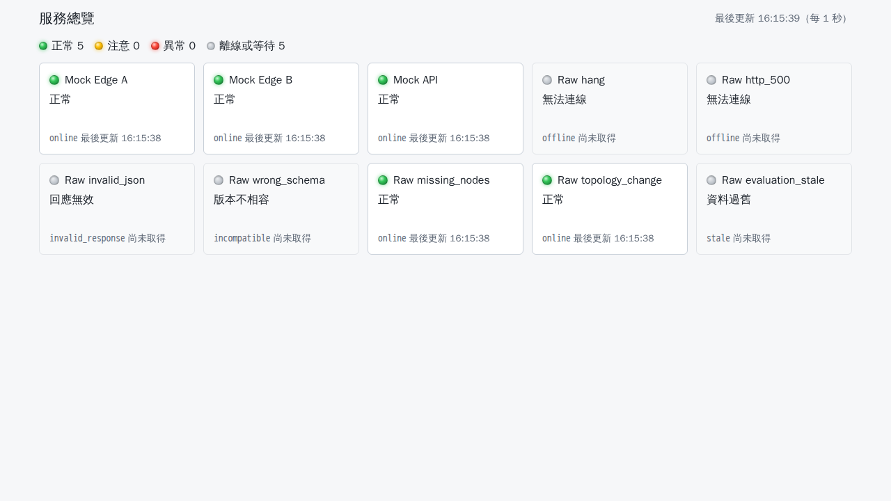
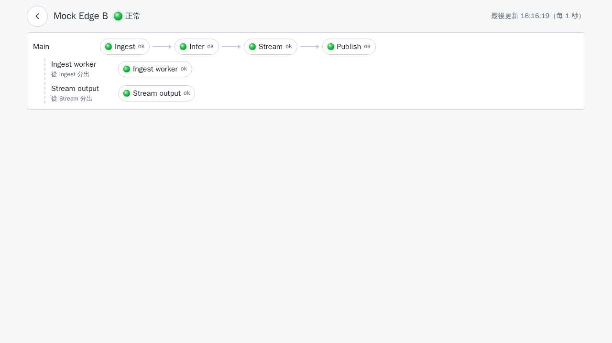

# smart-health

通用的服務健康狀態系統，由三部分組成：

- **函式庫 `smart-health-record`**（`packages/health_record`）：在各服務內記錄事實（開始、成功、錯誤、致命故障、指標），由獨立的評估執行緒推導節點狀態，並以 `GET /topology`、`GET /status` 提供。只使用 Python 標準函式庫。
- **Health App**（`apps/`）：後端（FastAPI）定期拉取各服務的 `/topology` 與 `/status`，前端（React + Vite）分成兩層：「服務總覽」以卡片列出所有服務的總體狀態，點進「服務畫面」查看架構圖、燈號與節點詳細資料。
- **通用契約**（`contract/`）：兩個接口的 JSON Schema 與 fixtures；不使用函式庫的服務只要符合契約也能被監控。

## 文件

| 文件 | 內容 |
|---|---|
| `docs/SPEC.md` | 規格書 |
| `CHANGELOG.md` | 函式庫與 Health App 各版本的變更 |
| `contract/README.md` | 契約與 `topology_version` 算法 |
| `docs/INTEGRATION.md` | 函式庫導入指南：範例、callable 不能阻塞、port、`message` 遮蔽與已知限制 |
| `docs/DEPLOY.md` | 部署說明：設定檔、compose、host 網路、網路安全限制 |
| `packages/health_record/README.md` | 函式庫簡介與最小範例 |

## 目錄結構

```text
contract/           契約文件、JSON Schema、fixtures 與契約測試
packages/           smart-health-record 函式庫（原始碼、測試、benchmarks）
apps/backend/       Health App 後端（FastAPI），requirements.lock 鎖定執行時依賴
apps/frontend/      Health App 前端（React + Vite）
examples/           模擬服務 mock_service（edge、api）與 raw_mock（7 種不合契約的模式）
config/             targets.example.yaml（範本）、targets.dev.yaml（只含模擬服務位址）
deploy/             Dockerfile 與 compose 檔
e2e/                Playwright 端對端測試
docs/               規格書、導入指南、部署說明與截圖
.github/workflows/  ci.yml（唯一的入口：ruff、單元測試，通過後呼叫 docker.yml）與 docker.yml（Health App 映像檔推到 Docker Hub）
```

## 本機測試

下列指令都從 repo 根目錄執行。需要 [uv](https://docs.astral.sh/uv/)、Node.js 22 與 Docker。

### Python

```bash
# 主要環境（Python 3.11）：契約、函式庫、後端、examples 與 lint
uv venv --python 3.11 .venv
uv pip install --python .venv/bin/python -r apps/backend/requirements.lock \
  pytest==9.2.0 anyio==4.16.0 jsonschema==4.26.0 ruff==0.8.4
uv pip install --python .venv/bin/python --no-deps -e apps/backend -e packages/health_record

.venv/bin/ruff check packages contract examples apps
.venv/bin/python -m pytest contract/tests -v --import-mode=importlib -W error
.venv/bin/python -m pytest packages/health_record/tests -v --import-mode=importlib -W error
.venv/bin/python -m pytest apps/backend/tests -q --import-mode=importlib -W error
.venv/bin/python -m pytest examples/tests -q --import-mode=importlib -W error   # 約 1 分鐘

# 函式庫相容性（Python 3.10）
uv venv --python 3.10 .venv-3.10
uv pip install --python .venv-3.10/bin/python -r contract/requirements-dev.txt -e packages/health_record
.venv-3.10/bin/python -m pytest contract/tests packages/health_record/tests -q --import-mode=importlib -W error

# 效能（不進 CI 判定）：record_success 單次平均必須低於 20 微秒
.venv/bin/python packages/health_record/benchmarks/bench_recorder.py
```

### 前端

```bash
cd apps/frontend
npm ci
npm run lint && npm run typecheck && npm test && npm run build
```

前端測試會讀取 `contract/fixtures`，所以必須在完整的 repo 內執行。

### 函式庫打包

```bash
uv venv --python 3.11 .venv-build
uv pip install --python .venv-build/bin/python build==1.2.2 twine==6.1.0
.venv-build/bin/python -m build packages/health_record
.venv-build/bin/twine check packages/health_record/dist/*
```

CI 不做打包檢查，發布 PyPI 前在本機執行上面的指令。

兩個 `pyproject.toml` 的 build-system 鎖定 `hatchling==1.27.0`，因為較新版本產生的 Metadata 2.5 會被 `twine` 6.1.0 拒絕（`'2.5' is not a valid metadata version`）。升級 hatchling 時要一併確認 twine 是否支援新的 Metadata 版本。

### GitHub Actions workflow

```bash
docker run --rm -v "$PWD:/repo" -w /repo rhysd/actionlint:1.7.7 -color
```

輸出必須為空。

## CI

`ci.yml` 是唯一的入口，測試全部通過後才呼叫 `docker.yml`（reusable workflow）。

| Workflow | 觸發 | Jobs（GitHub 上的名稱） |
|---|---|---|
| `ci.yml` | push 到 `main`、push `app-vX.Y.Z` tag、pull request、手動（`workflow_dispatch`）；只改 `**/*.md`、`docs/**` 時跳過（tag 不套用路徑過濾） | `ruff`、`record`（Python 3.10 與 3.11：契約與函式庫測試）、`backend`、`examples`、`frontend`（lint、typecheck、test、build），以及 `docker`（呼叫 `docker.yml`） |
| `docker.yml` | 只由 `ci.yml` 的 `docker` job 呼叫（`workflow_call`），`needs` 上面 5 個測試 job | `docker / image`：建置 `linux/amd64`、`linux/arm64`，兩個平台都 smoke test，通過後推到 Docker Hub |

- 任一測試 job 失敗時，`docker / image` 不執行，不會推送映像檔。push 版本 tag 時也會重跑全部測試。
- 測試 job 不使用 secrets；只有 `docker` job 明確傳入 `DOCKERHUB_TOKEN`（不用 `secrets: inherit`）。pytest 一律加 `--import-mode=importlib -W error`。
- concurrency 只設在 `ci.yml`：pull request 以 ref 分組並取消舊執行；push 與手動執行以 commit 分組、不取消，同一個 commit 的 `main` 與 tag 執行會排隊。
- `docker / image`：
  - pull request（包括 fork）只建置與 smoke test，不登入、不推送，也不使用 secrets；
  - push 到 `main` 與手動執行推送 `sha-<commit 前 7 碼>`；
  - push `app-vX.Y.Z` tag 時推送 `X.Y.Z`，版本必須等於 `apps/frontend/package.json` 的 `version`；
  - 不推送 `latest`，已存在的 tag 不覆寫。
  - 需要的 GitHub 設定、tag 規則與發布步驟見 `docs/DEPLOY.md` 第 4、5 節。
- 下列檢查**不在 CI 執行**，修改相關部分或發布前在本機執行：
  - e2e（見下方「端對端測試」）：

    ```bash
    docker compose -f deploy/docker-compose.dev.yml up --build --wait
    e2e/run.sh
    docker compose -f deploy/docker-compose.dev.yml down
    ```

  - 函式庫打包檢查（見上方「函式庫打包」）：

    ```bash
    .venv-build/bin/python -m build packages/health_record
    .venv-build/bin/twine check packages/health_record/dist/*
    ```

- PyPI 發布由維護者手動執行。

## 部署與導入

- 部署（設定檔、compose、host 網路、無登入驗證的網路限制、映像檔）：`docs/DEPLOY.md`。
- 讓服務使用函式庫：`docs/INTEGRATION.md`。

## 開發環境（Health App + 所有模擬服務）

```bash
docker compose -f deploy/docker-compose.dev.yml up --build --wait
# 瀏覽 http://127.0.0.1:18000（服務總覽）
docker compose -f deploy/docker-compose.dev.yml down
```

- 畫面以網址的 hash 區分：`#/` 是服務總覽（第 N 頁為 `#/?page=N`），`#/targets/<id>` 是服務畫面，例如 `http://127.0.0.1:18000/#/targets/mock-edge-b`。上一頁、下一頁、重新整理和書籤都能用。
- 畫面（SPEC §7.1）：
  - 燈號是發光的號誌風格，綠、黃、紅亮燈有光暈，灰色是沒亮的燈；狀態文字照常顯示，顏色不是唯一線索。
  - 總覽卡片依總體狀態使用淡色底（正常白底、注意淡黃、異常淡紅、離線或等待淡灰）。
  - 服務畫面左上角的圓形箭頭圖示是「回到總覽」。
  - 主迴圈（`sequential` 且 2 個以上節點的 lane）全綠時，光點沿箭頭流動、經過的節點短暫變亮。系統設定減少動態效果或寬度 640px 以下時不流動。光點是裝飾，速度固定，不代表實際的處理量。

| 服務總覽 | 服務畫面（正常） |
|---|---|
|  |  |

- 專案名稱固定為 `smart-health-dev`，網路為 `smart-health-dev_default`。
- 包含 `health-app`、`mock-edge-a`、`mock-edge-b`、`mock-api` 與 7 個 `raw-*`（每個 raw_mock 模式一個）。每個 service 都有 healthcheck，`--wait` 會等到全部 healthy。
- 只有 `health-app` 發布 `127.0.0.1:18000`；模擬服務只在 compose 網路內可見。
- 目標設定為 `config/targets.dev.yaml`（只含模擬服務位址，拉取間隔 1 秒、請求逾時 3 秒）。
- 切換 edge 情境：`docker compose -f deploy/docker-compose.dev.yml exec mock-edge-b python -c "import urllib.request as u; print(u.urlopen(u.Request('http://127.0.0.1:19081/scenario', data=b'{\"name\": \"camera_down\"}', method='POST')).read())"`。
- 本機 docker 沒有 buildx 時，compose v2.24.5 仍可用 Docker Engine 內建的 BuildKit 建置；`docker build` 則會使用 legacy builder 並顯示棄用警告，兩者都能建置成功。legacy builder 沒有 `BUILDPLATFORM`，前端階段固定用 `linux/amd64`，所以 arm64 主機不能用 legacy builder 建置（見 `docs/DEPLOY.md` 第 4 節）。

## 端對端測試（e2e）

e2e 在官方 Playwright Docker 映像檔內執行，對 dev compose 中的**真實後端**測試，本機不需安裝瀏覽器或系統套件：

```bash
docker compose -f deploy/docker-compose.dev.yml up --build --wait
e2e/run.sh                      # 可附加 playwright test 參數，例如 e2e/run.sh --grep starting
docker compose -f deploy/docker-compose.dev.yml down
```

`e2e/run.sh` 的做法：

- 從 `e2e/package.json` 讀出 `@playwright/test` 的確切版本，組出 `mcr.microsoft.com/playwright:v<版本>-noble`，兩者一定一致。
- 用 `docker run --rm` 加入 `smart-health-dev_default` 網路，在容器內 `npm ci && npx playwright test`，`baseURL` 為 `http://health-app:8000`。
- 以目前使用者的 uid/gid 執行，`HOME` 與 npm cache 放在容器的 `/tmp`，不產生 root 擁有的檔案。
- 掛載 `/var/run/docker.sock` 並加入 socket 的群組，讓測試透過 Docker Engine API 停止與恢復 `mock-edge-a`。**只在本機或用完即丟的測試環境執行；共用主機與自架 runner 不要掛載 Docker socket。** e2e 不在 CI 執行。
- 只掛載 `e2e/` 與 `docs/screenshots/`（以 `E2E_SCREENSHOT_DIR` 傳入），容器內讀不到 `.env`、`config/targets.yaml` 等其他檔案。
- 情境切換透過 mock 的控制接口（`POST /scenario`）；情境測試用 `mock-edge-b`，停止與恢復用 `mock-edge-a`。
- 截圖輸出到 `docs/screenshots/`（`overview`、`normal`、`camera_down`、`offline`、`mock-api`、`mobile`、`mobile_overview`），以 `animations: "disabled"` 截取靜態畫面，光點流動不會出現在截圖中。

測試內容：

| 檔案 | 內容 |
|---|---|
| `scenarios.spec.ts` | SPEC §8.2 的 14 個情境，驗證每個節點的狀態文字與顏色 |
| `robustness.spec.ts` | raw_mock 7 個模式、`mock-edge-a` 停止與恢復、hang 不影響其他目標 |
| `generic.spec.ts` | `mock-api` 的巢狀 lane |
| `navigation.spec.ts` | 總覽 → 卡片 → 服務 → 回到總覽、直接開啟服務網址、找不到服務 |
| `responsive.spec.ts` | 寬度 360px 時總覽與服務畫面都不水平捲動 |
| `visual.spec.ts` | 發光燈號、卡片淡色底、回到總覽圖示、光點流動的條件，以及 reduced motion 與 640px 以下不流動 |
